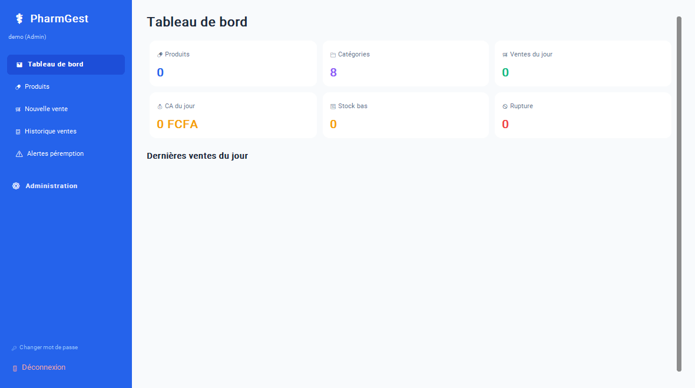
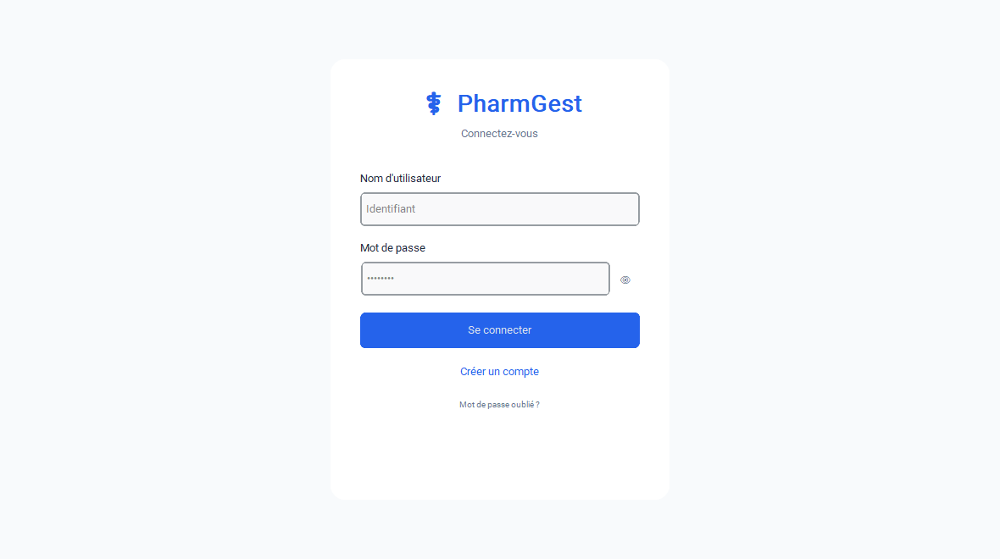
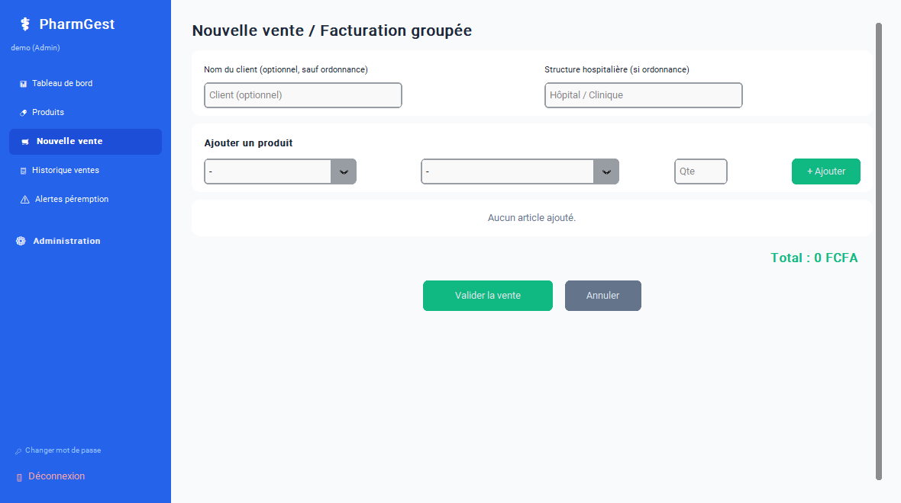
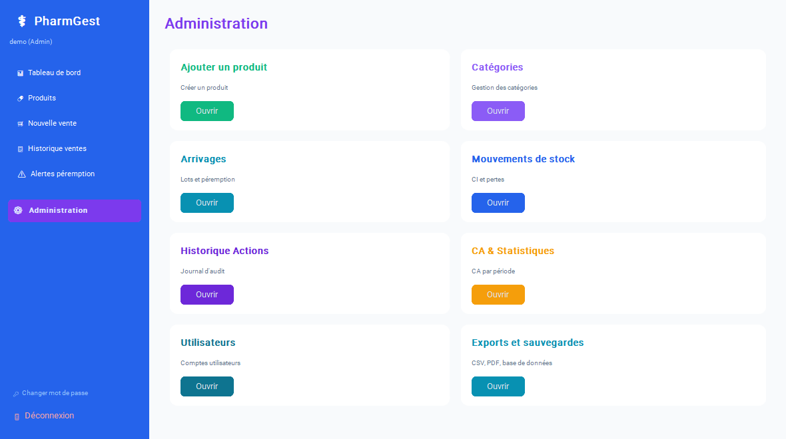
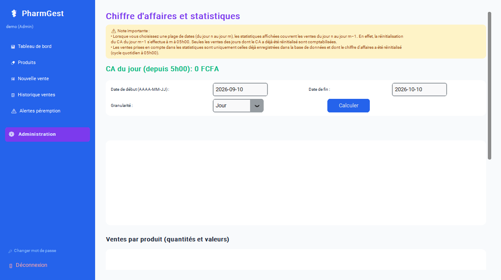

# PharmGest: pharmacy management desktop application (Python)

A desktop application to run a small pharmacy: users and roles, product catalogue, batch stock with expiry dates, cart sales with PDF invoices, dashboard and sales statistics.

> Academic project for the *Advanced Python* course at ENSAE Pierre Ndiaye, Dakar (ISE1, February–March 2026).
> **Team:** Joo Young Véridique Gabriel DIOP · Herman Parfait NGAKE YAMAHA · Sènou Michel-Marie Trésor TEVOEDJRE



## Features

- **Accounts**: secure login, account creation, password reset via a security question, admin and user roles. Passwords are stored hashed.
- **Products and categories**: catalogue, search and filters, add, edit and delete.
- **Stock by batch**: arrivals with batch number and expiry date, expiry alerts, stock movements (internal use, losses).
- **Sales**: grouped sales (cart), PDF invoices, cancellation, sales history.
- **Dashboard and statistics**: daily figures, turnover by period, sales by product and by category.
- **Administration**: user management, CSV/PDF exports, database backup, audit log of every action.

The full feature list is in [`docs/PharmGest_fonctionnalites.pdf`](docs/PharmGest_fonctionnalites.pdf).

## Architecture

```
PharmGest/
├── main.py       entry point: initialises the database, then launches the interface
├── models.py     domain classes (abstract base entity, Product, Batch, Sale, User…)
├── database.py   SQLite access layer (tables, queries, backups)
└── gui.py        customtkinter interface (one class per screen)
```

Object-oriented design: an abstract base entity, encapsulated attributes, and a clear separation between models, data access and interface.

## Run

```bash
pip install -r requirements.txt
cd PharmGest
python main.py          # on Windows you can also double-click PharmGest.bat
```

The SQLite database (`pharmacie.db`) is created on first launch. The first account you create becomes the administrator.

## Screenshots

| Login | Cart sale |
|---|---|
|  |  |
| **Administration** | **Turnover and statistics** |
|  |  |

Stack: Python 3 · customtkinter · SQLite · matplotlib · fpdf2
